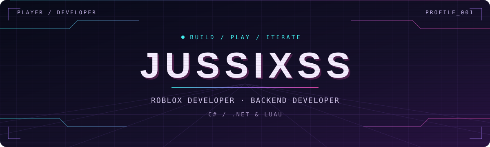
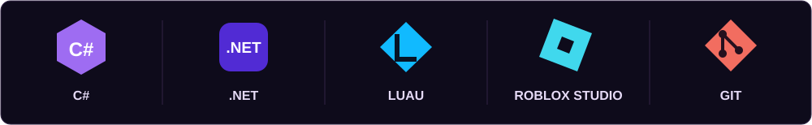
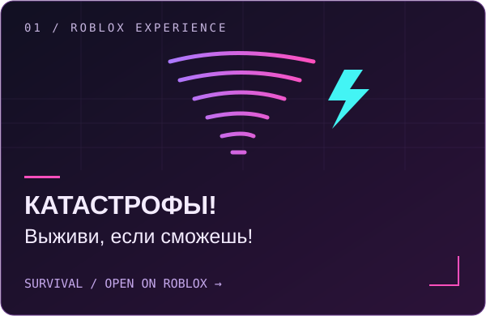
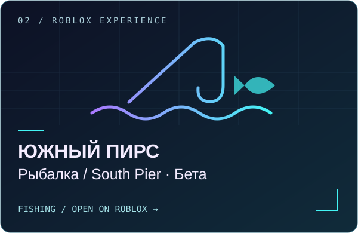
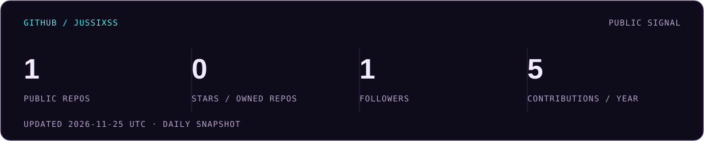
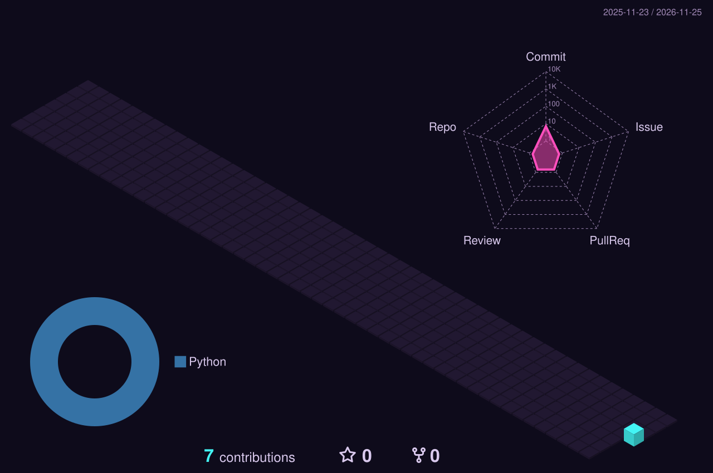

  

  

  <b>Game Systems &nbsp; / &nbsp; Backend &nbsp; / &nbsp; Software Architecture</b>

  <a href="#01--about-me">About</a> &nbsp; · &nbsp;
  <a href="#02--languages--tools">Stack</a> &nbsp; · &nbsp;
  <a href="#03--roblox-experiences">Games</a> &nbsp; · &nbsp;
  <a href="#04--github-signal">Activity</a>

## 01 / About me

I'm a developer focused on **Roblox game development** and **backend engineering**.
Interested in scalable systems and clean architecture.

| Roblox Development | Backend Development |
| :--- | :--- |
| Game mechanics, gameplay systems and server-side logic. | C# / .NET applications and services. |

## 02 / Languages & Tools

  

## 03 / Roblox experiences

  
  

| Experience | Play |
| :--- | :--- |
| **КАТАСТРОФЫ! Выживи, если сможешь!** — раунды выживания среди стихийных бедствий. | [Открыть в Roblox ↗](https://www.roblox.com/games/138250118688212/unnamed) |
| **Южный пирс — рыбалка (South Pier)** · Бета — рыбалка и продажа улова за монеты. | [Открыть в Roblox ↗](https://www.roblox.com/games/114913147626085/South-Pier) |

## 04 / GitHub signal

  

### Contribution snake

  

### 3D contribution skyline

  

  Generated daily from the activity GitHub makes available to the workflow. 
  <a href="https://github.com/Jussixss/Jussixss/actions/workflows/profile-assets.yml">Asset refresh status ↗</a>

  

